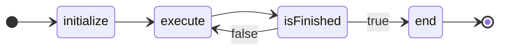

### Goals:
- Provide human input to the robot
- Have a fully controllable chassis


# Coding up a controller

Most example projects have a controller. In the ones we'll use, it's usually in `RobotContainer.java`.

There's a few different ways to construct controller objects, but the common one is `CommandXBoxController`

```java
public class RobotContainer{
	private final CommandXboxController joystick = new CommandXboxController(0);
}
```

The `CommandXboxController` have extra features that we'll be using to streamline code, and access buttons by name (like `.x()` and `.y()`) which aren't available on other joystick variants like `CommandJoystick` or `Joystick`

Now that we have our joystick, we have several ways to interact with it, but we don't have the code mechanics to do so yet. We need to understand two important topics

# Switching behaviours with Commands

A `Command` is a code structure that represents a behavior or action. This can be of a single mechanism (like the drivetrain, an intake, or roller) or of the whole robot. It's best to think of these as the "verbs" of the robot. You "Command" it to do something, and it does that until it's time to stop.

Using Commands, we can adjust our example from  [[Basic Motor Control]], into a set of Commands that better describe what we want the chassis to do.

We previously had this:

```java
	public void periodic(){
		differentialDrive.arcadeDrive(0.2,0); 
	}
```

and found that this wasn't easy to manipulate. As written, we cannot change the actual bot behavior without changing the code. So, let's move that useful operation (setting the motor) and convert it to a few different Commands

```java
public class ExampleSubsystem extends SubsystemBase{
	SparkMax motor = new SparkMax(10, MotorType.kBrushless);
	
	public void periodic(){
		//Remove our motor call from here
	}
	
	public Command forward(){
		return run( ()->{ differentialDrive.arcadeDrive(0.2,0); } );
	}
	
	public Command backward(){
		return run( ()->{ differentialDrive.arcadeDrive(-0.2,0); } );
	}	
	
	public Command stop(){
		return run( ()->{ differentialDrive.arcadeDrive(0,0); } );
	}
}
```

### Explaining the syntax
For now, let's focus on the simple Run command. This Command type runs the provided code every loop while the command is active. 

The `run(...)` command is one of several helper functions for building Commands. We'll talk more about these when looking at sequencing and building autos.

The strange syntax is called a "[[Lambdas|Lambda]]" or "Anonymous Function". It's just  like a typical function (you run the code inside when the function/lambda called, not when you encounter it in the file), but it has some special syntax to let you put that code inside other functions.

Our `run(...)` needs a function (or Lambda) that  accepts no arguments. So, let's start with a Lambda that did nothing which looks like`()->{};` . Now we have the structure we need, so we can stuff in our motor command `differentialDrive.arcadeDrive(0.2,0)`, and get `()->{ differentialDrive.arcadeDrive(0.2,0); }`. 

Now we have a Lambda that does what we want, and shove it into our `run(...)` method. This gives us the final result seen above: `run(()->{ differentialDrive.arcadeDrive(0.2,0); });` . 

Having given our `run(...)` function the right input, it now that generates a new Command, and then lets us access it! Hooray!

However, to go one step further we generally we actually want nicer names to deal with in code. So, instead of just using `run(...)` directly (and building it everywhere we need to set the motor, we instead put it inside a function (forward, backward, or stop) and return it from there.

Now we can easily put `stop()` or `forward()` anywhere we want a new Command to represent that action. 

While a bit complicated, this type of function (a function that takes one thing and returns a newly built object) is called the [[Code Patterns|Factory Pattern]]. The `run(...)` is one of several factory methods we'll encounter to make commands. 

# Subsystems (aka Mechanisms)

A Subsystem represents an actuator or actuator group, or simply "a mechanism". We often use it to separate out code for that mechanism so it's a bit easier to deal with.

However, Commands also interact with Subsystems using the `requirements` conventions. A subsystem can't do two things at once, so it doesn't make sense to have two Commands at once. When a new Command starts, old commands stop running.

Breaking down mechanical parts of the bot into "subsystems" is not relevant yet, but we'll come back to that.

`[!!flame|2027 Season Code|var(--color-cyan-rgb)]` will be renaming Subsystems as Mechanisms , as it better describes what's happening.

# Periodic condition checking with Triggers

`Triggers` represent some process that returns a true or false value. These are useful because Triggers get checked automatically, and make it easy to act on specific values, or changes in those values. We'll discuss them more later; They're often used for sensors.

For now, the only Triggers we care about are the controller buttons. We want to know "is it pressed", and `CommandXboxController()` provides these triggers for us with handy names.

```java
joystick.x() //Trigger that represents X being pressed
joystick.y() // trigger that represents Y being pressed
// And so on
```

For now the most useful parts of Triggers are these two:
```java
// Runs a command while a button is held,
// stopping the command when the button is released
joystick.x().whileTrue(/**/)

// Runs a command when a button is pressed, but never stops it.
joystick.y().onTrue(/**/) 
```

# Controlling the robot

At last, we have all the parts in place to actually operate the robot via buttons. 

```java
// In RobotContainer.java
public class RobotContainer{
	// This function is called by the consturctor, Robotcontainer().
	// It's just here  to  help us organize our button assignments.
	private void configureBindings() {
		joystick.y().whileTrue(exampleSubsystem.forward())
		joystick.a().whileTrue(exampleSubsystem.backward())
	}
}
```

We can upload this new code to the robot, and we'll see the expected result! Go ahead, do it! 

Once you press Y the robot goes forward, and pressing A makes it go backwards. 

However, you *might* notice that releasing the button doesn't make it *stop*. This  probably *feels* unexpected, but this is *precisely* what we told the robot to do. Let's explain why.

### Command Life Cycles

For a comprehensive explanation, see [[Commands]].

For a simpler explanation, we can break down what we wrote.
- We pressed a button; This causes the command we bound to the button to activate. 
- Our robot's scheduling system starts the appropriate command (`forward()` or `reverse()`) .
- This command, when running, just sets the motor to forward or backward.
- We release the button; This causes the Command to end. 
- However.... this doesn't change anything; We haven't told the command to do something useful when it ends (like stopping the motor)
- As such, the motor is still set to whatever value we had given it. 

There's a few ways to fix this, but the most straightforward is to have our Command turn the motors off when it stops. We can look at ExampleCommand.java for some help, and we'll see a few functions. 

```java
//This is a shortened version of the file
class ExampleCommand extends CommandBase{
	public ExampleCommand(){}
	public void initialize(){}
	public void execute(){}
	public boolean isFinished(){ return false; }
	public void end(boolean cancelled){}
}
```

Behind the scenes, the robot runs a command scheduler, which runs these functions in a predictable order when the command is created, starts, and stops. Once started, a command will run according to the following flowchart, more formally known as a [[State Machines|state machine]]. 



End is called when the command ends naturally (when isFinished says it's done), or when it's cancelled (such as when we release a button).

Currently,  our commands only have  one useful line of code, which the `run(...)` command puts in the `execute` step: While the command is running, it runs this every robot loop. This means, we set our motor values. 

What we want *now* is to do something when the command stops, using the `end()` block. We do this by "decorating" our command with another lambda. Let's do this on the `forward` command.

```java
public class ExampleSubsystem extends SubsystemBase{
	public Command forward(){
		return run( ()->{ differentialDrive.arcadeDrive(0.2,0); } )
		.finallyDo( ()->{ differentialDrive.arcadeDrive(0,0); }; )
		;
	}
}
```

We can also simply use a different command helper. There's several for different situations, but one with the straightforward name `runEnd`; This just takes _two_ different lambdas, representing the execute and end code.
```java
public class ExampleSubsystem extends SubsystemBase{
	public Command forward(){
		return runEnd(
		  ()->{ differentialDrive.arcadeDrive(0.2,0); },
		  ()->{ differentialDrive.arcadeDrive(0,0); };
	    );
	}
}
```


# OK but this is complicated I just wanted to drive the robot?

First, that's not a question. 

But it's because robots are complicated! The "simple" and easy to explain way to grab a joystick (using functions like `periodic`) to a robot *will* work, but not for long.

As you try to get more out of your robot, you'll quickly find the "simple" way stops working well, and your code will quickly spiral into an unmanageable mess. It doesn't take a lot of buttons before the "simple" way becomes very difficult to work with, debug, and reason about. Especially with multiple people involved.

In FRC, Commands tend to be a good solution for these (and other) problems, and give us a good way to handle it. You can only run one command at a time, and most commands are just a few simple lines of code, so debugging can be straightforward.

The hard part, instead, is figuring out how all the parts are glued together. It's tricky now, but will make perfect sense after a bit of practice. 

# A more advanced robot

We now have fixed our `forward()` command, so let's add that fix to our `backward` command too. 

We also lack turn commands, so make `left()` and `right()` command. They'll  look very similar to the examples above, but will be left as an excercise for you. If you get stuck, ask a mentor or partner!

Once those are done, connect them to the other buttons using  `joystick.b()` and `joystick.x()`. Again, very similar. 

You should now be able to drive the robot around the room using the buttons. 

# But I want a joystick! 

That's up next! See [[Analog Drivetrain Control]].

