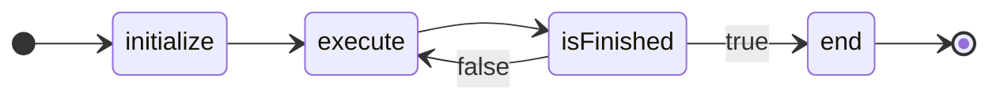

# Establishing the Subsystem Type

For this example, we're creating a basic Roller subsystem. Rolllers are a way we refer to very broad class motorized mechanisms.

Roller systems, at their core, are usually defined by 
- Being stationary mechanisms
- Having one or more wheels or bars that interface with a controlled element (usually our game piece)
- Causing the translation (movement) of a controlled item (and sometimes rotating the item in the process)

Beyond that, rollers have a *very* diverse set of ways they're constructed, including opposing pairs and multi-roller sets, with high speed to high power. 

They also have a large number of useful applications, from simple transport or alignment, to intakes, scoring mechanisms, launchers, and grabbers. They're also often a sub-component of other systems, like feeders or grabbers. 

Since they have a lot of roles, we rarely call something a "Roller" system, and usually give them more fun names based on their practical function in the robot. 

# Create the Roller Subsystem File

We haven't created a Subsystem/Mechanism yet, so here's how: 

Right click the Subsystems folder in your file view on the left side, and scroll down until you see `Create a new class/command`
![[Pasted image 20260926225132.png]]

This will provide a few options on the top of the VS Code window. 
![[Pasted image 20260926225246.png]]

In this case, we want a Subsystem, so select that. This will then request a name, and let's go with Roller for now. 
![[Pasted image 20260926225424.png]]

This creates the Subsystem and provides the basic structure, similar to our ExampleSubsystem we used earlier. 

# Deciding the Commands to make

Normally,  the first thing we need to do when creating a system is figuring out their names. Commands usually describe actions, so we often default to having the name be a verb.

Good names also describe the _intent_ of the action. Our hypothetical has no real-world function, so we only can make awkward names like "spinForward" or "spinReverse". So, for now let's assume this robot has a role similar to the Intake on our kitbot. This gives us two useful actions: Loading game pieces into the bot, or unloading game pieces. In this case, we can pick matching verbs like `load` and `unload`, or `intake` and `eject`. 

Next, we want to check if these actions require external information. For our Drivetrain, we had several actions like forward and backward that needed no additional data; We simply used a hard-coded value for our motor value. However, driving with a joystick _did_ require us to pass in the joystick or values from it. 

Since we want reliable, repeatable commands, so we want to avoid relying on external data when we can. This makes our code easier to read and maintain, and allows us to better update it as our robot changes. 

At the end of this, we should end up with two functions. For the sake of the example, let's roll with
- `intake()`  , which runs our motor one way
- `eject()` , running it the other way. 


# Write the code

At this point, you are equipped to create these commands and make them work!  Give it a shot! 
#### Reminders of the steps
In case you need a roadmap, here's what you need to do 
- Create the `motor` (remembering the correct imports, and matching the motor IDs)
- Configure the motor (again, import issues)
- Create the functions that return our commands
- provide them with the correct names
- Create an instance of the subsystem in RobotContainer.java
- Attach your commands to buttons

### Sample Code
When you're done, you should have something similar to this:
```java
public class Roller extends SubsystemBase {

  private SparkMax motor = new SparkMax(
    30,//Will change based on hardware; 30 will not work on anything
    MotorType.kBrushless
  );

  public Roller() {
    var config = new SparkMaxConfig();
    // ... Configuration omitted in example since it's long
    motor.configure(/* ... */);
  }

  public Command intake(){
	//Set low for safety
    return run( ()->{motor.set(0.1);} ); 
  }
  public Command eject(){
    return run( ()->{motor.set(-0.1);} );
  }
  
  // ... default periodic
}
```

And in our robotContainer
```java
public class RobotContainer{
	private void configureBindings() {
		//You may decide on different buttons, that's fine!
		//We'll use these for the purposes of the examples
		joystick.rightTrigger().whileTrue(roller.intake())
		joystick.leftTrigger().whileTrue(roller.eject())
	}
```

#### Code Considerations
There's a lot of potential code bits that rely on hardware! If 

This includes 
- The motor ID is very specific to the robot. Check the robot or with a mentor.
- The `config.inverted(...)` value; We normally use a convention of "toward scoring" is positive, so we expect `intake` to have a positive motor value. 
- The `config.smartCurrentLimit(...)` is likely to be low (5-10) but may vary. 
- The motor output values likely should increase in real systems. These really vary and work alongside the current limit to determine how much force the rollers can apply to a game piece.

# Upload and test

If you haven't already, get some hardware and test this code out! 

What you should observe is that the left trigger makes it spin one way, and the right trigger makes it go the other. 

However, you *might* notice that releasing the button doesn't make it *stop*. This probably *feels* unexpected, but this is *precisely* what we told the robot to do. Let's examine why.

### Command Life Cycles

For a comprehensive explanation, see [[Commands]].

For a simpler explanation, we can break down what we wrote.
- We pressed a button; This causes the command we bound to the button to activate. 
- Our robot's scheduling system starts the appropriate command (`intake()` or `eject()`) .
- This command, when running, just sets the motor to forward or backward.
- We release the button; This causes the Command to end. 
- However.... this doesn't change anything; We haven't told the command to do something useful when it ends (like stopping the motor)
- As such, the motor is still set to whatever value we had given it. 

There's a few ways to fix this, but the most straightforward is to have our Command turn the motors off when it stops. We can look at ExampleCommand.java for a reference, and we'll see a few functions we haven't interacted with. 

```java
//This is a shortened version of the file
class ExampleCommand extends CommandBase{
	public ExampleCommand(){}
	public void initialize(){}
	public void execute(){}
	public boolean isFinished(){ return false; }
	public void end(boolean cancelled){}
}
```

Behind the scenes, the robot runs a command scheduler, which runs these functions in a predictable order when the command is created, starts, and stops. Once started, a command will run according to the following flowchart, more formally known as a [[State Machines|state machine]]. 



`end()` is called when the command ends naturally (when isFinished says it's done), or when it's cancelled (such as when we release a button).

Currently,  our commands only have  one useful line of code, which the `run(...)` command helper puts in the `execute` step: While the command is running, it runs this every robot loop. This means, we set our motor values. 

What we want *now* is to do something when the command stops, using the `end()` block. We do this by "decorating" our command with another lambda. Let's do this on the `forward` command.

```java
public class Roller extends SubsystemBase{
	public Command intake(){
		return run( ()->{ motor.set(0.2); } )
		.finallyDo( ()->{ motor.set(0); } )
		;
	}
}
```

We can also simply use a different command helper. There's several for different situations, but one with the straightforward name `runEnd`; This just takes _two_ different lambdas, representing the execute and end code.
```java
public class Roller extends SubsystemBase{
	public Command intake(){
		return runEnd(
		  ()->{ motor.set(0.2); }, 
		  ()->{ motor.set(0); }
	    );
	}
}
```

# Why didn't this happen on the Drivetrain?

The DifferentialDrive class (which the drivetrain uses) has special safety features: If you don't set a value every loop (eg, in `periodic` or an active command's Execute/Run code) then it resets, resulting in the robot stopping. 

However, when directly talking to smart motor controllers like the Rev ones, we *do not* have that! 

# Stop commands  + Defaults

Explicitly stopping is usually a very important action, and not one we discussed up above. But we should have! All subsystems should have some sort of sane "idle" behaviour, and often "stop moving" is a good starting point. 

It's simply good practice to make sure that a Command that turns on a motor stops it when the Command exits, as this avoids potential bugs and surprises.

Another way we could "stop" the motor is using default commands! Just like our Drive Train, we can establish the default command. Unlike the drive train, for now we don't need anything too fancy, and we can handle this inside the command itself rather than RobotContainer. 

```java
public class Roller extends SubsystemBase{
	//Our constructor function
	public Roller(){
		// ... Other stuff will be here
		setDefaultCommand(stop());
	}

	public Command stop(){
		return run( ()->{ motor.set(0); } );
	}
}
```

In general, you actually want _both_ explicit off-on-exits,  The details of why won't be clear yet (and may not be a problem after kickoff), but relate to sequences which we'll see when constructing autos. 


# Clean up! 

As before, note we have multiple commands now that just wrap `motor.set(...)`: `intake()`, `eject()`, and `stop` . We also might want to add _more_ such named commands, and at some point we start having a lot of copy-paste operations. 

Just like the drivetrain, create a new command that takes a DoubleSupplier parameter, then use that to set the motor speed. Then, refactor your existing commands to just return that one with a preset value. 

Give it a shot on your own, and if you need help use the sample code below

# Final sample code

```java
public class Roller extends SubsystemBase {

  private SparkMax motor = new SparkMax(
    30,//Will change based on hardware; 30 will not work on anything
    MotorType.kBrushless
  );

  public Roller() {
    var config = new SparkMaxConfig();
    // ... Configuration omitted in example since it's long
    motor.configure(/* ... */);
    setDefaultCommand(stop());
  }
  
  public Command runMotor(DoubleSupplier output){
    return run( 
	    ()->{ motor.set(output.getAsDouble()); }
	)
	.finallyDo(
		()->{ motor.set(0); }
	)
	;
  }
  
  public Command intake(){
    return runMotor(()->0.1);
  }
  public Command eject(){
    return runMotor(()->-0.1);
  }
  public Command stop(){
    return runMotor(()->0);
  }
  
  // ... default periodic
}
```

